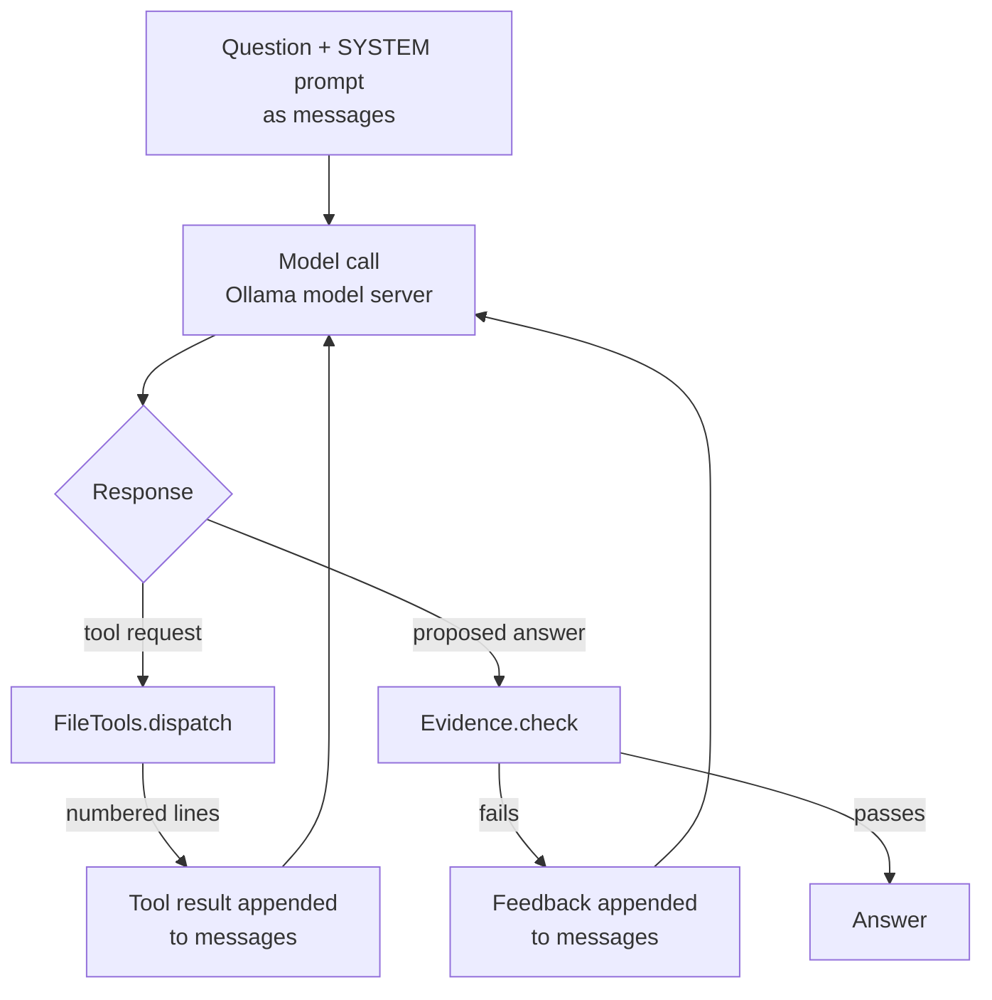

# Baby Anigans

**A tiny research assistant you can read end to end.**

Ask a question about a local text file. Baby Anigans searches it, reads nearby lines, and answers with line citations. The point is what happens in between: a model requests actions, and a short Python program carries them out. By the end you should be able to point to the **model**, **tools**, **context**, and **harness** in a running agent.

Built for [Agency with AI](https://agencyai.mit.edu), MIT 6.S950. The [project spec](project-spec.md) describes Baby Anigans itself; `spec.txt` is fictional source material for it to read.

## 1. Run it

Requires Python 3.10+ and [Ollama](https://ollama.com/download). The default model is a 1.4 GB download; no Ollama account is needed.

```sh
git clone git@github.com:agency-with-ai/baby-anigans.git
cd baby-anigans
python3 -m venv .venv && source .venv/bin/activate   # Windows: .venv\Scripts\Activate.ps1
python -m pip install -r requirements.txt
ollama pull qwen3:1.7b

python agent.py "What should happen if the feed is unavailable?" --trace first-run.jsonl
```

If Ollama is not already running, start `ollama serve` in another terminal. Other models and remote endpoints: [reference](docs/reference.md#model-options).

Open [spec.txt](spec.txt) beside the answer. Does the cited line say what the answer claims? The small model can fail or hit the step limit. Keep the output anyway; a failed run shows the mechanism just as well.

## 2. Follow a search into the code

Find a `[tool]` event in the terminal, for example:

```text
name: search
arguments: {"query": "feed unavailable"}
```

**The model requested a search. It did not search your disk.** In [agent.py](agent.py):

1. `TOOLS` describes `search` and its arguments. This schema is what the model sees.
2. `FileTools.dispatch` maps the requested name to an allowed Python function.
3. `FileTools.search` does the matching and returns numbered lines:

```text
25: If the feed is unavailable, report the failure and write no shortlist.
```

The line number comes from Python, not from the model. Search is plain substring matching: every query term must occur on the same line. There is no embedding model or vector database.

**Before moving on:** to change what "search" means, would you edit the tool description, the Python function, or both?

## 3. How the model sees the result

`run_agent` repeats one loop until an answer passes the checks or the step budget runs out:



Everything outside the model box is the Python program in `agent.py`.

The returned line becomes a **tool-result message**. That is the only way file text reaches the model. Open `first-run.jsonl` and compare the `messages` of the first two `request` records: the later one contains what the tool returned. This growing input is the model's **context**.

The file existed on disk the whole time, but the model saw nothing until a tool returned it. **On disk, reachable through a tool, and present in context are three different things.**

Traces are never overwritten; pick a new filename for each run.

## 4. Why read after searching?

```sh
python agent.py "Are all screened entries marked read?"
```

The source has a rule and an exception on the next line:

```text
29: After a successful sweep, mark screened entries read.
30: Exception: leave borderline entries unread until the instructor reviews them.
```

A search can return line 29 alone. The second tool, `read_lines(start, end)`, lets the model fetch the surrounding text. Inspect the run: which words did the model search for? Did it retrieve the rule, the exception, both? If the answer was wrong, was the evidence missing from context, or mishandled after it arrived?

The small model sometimes searches for "all" and finds nothing. That is a poor query, not proof the file lacks an answer.

## 5. Where is the harness?

You may also see `[check]` events:

```text
Search the file before answering.
Read neighboring lines too, not only the match.
Cite the retrieved evidence using [L25] or [L25-L26].
```

These are **not model output**. They come from `Evidence.check` in `agent.py`. When a proposed answer fails a check, Python appends the feedback and calls the model again, within a fixed call budget.

This surrounding program is the **harness**: it builds context, dispatches actions, returns observations, checks the answer's form, and decides whether to continue or stop. Ollama is the **model server**, a separate program.

Two lines of defense: `SYSTEM` asks the model to cite evidence, and Python checks that citations point to lines the tools returned. The first is an instruction; the second enforces a narrow property. **Neither proves the cited passage supports the claim.**

For a file this short, pasting the whole numbered file into one prompt would be simpler. Tools are used here to expose how an agent gathers information over several calls.

## 6. Change one component

Predict what will change, then check the trace.

- **Change the model:** `ollama pull qwen3:8b`, then add `--model qwen3:8b`. Different searches? Fewer corrections? Does it keep the exception?
- **Remove a tool:** add `--search-only`. This drops `read_lines` and its check. The model may still find the exception by searching again.
- **Change the evidence:** add `--file /path/to/your-notes.txt` with a question you can verify. Then ask something the file does not answer. Does the agent distinguish "found nothing" from "no answer exists"?

## More

- [Reference](docs/reference.md): hardware, remote inference, options, limits, tests.
- [Tests](test_agent.py): harness checks using fake model responses, no Ollama required.

[MIT license](LICENSE).
